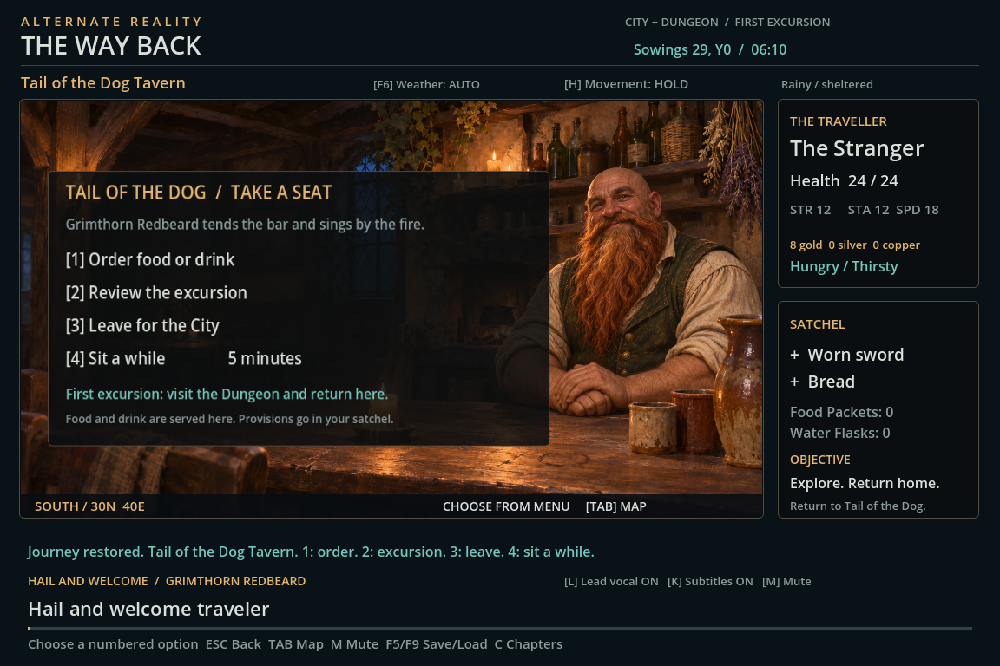

# S31 — Physical Speed persistence and acceptance

Completed 2026-11-20. All six criteria pass. This closes the bounded F01
rule/effect feature; it does not add guild acquisition, combat casting or a
complete spell/item/ailment catalogue.

## Production path

`journey_effects.gd` installs versioned, trusted Physical Speed definitions into
S30's runtime. Successful activation allocates the expiry/text group and grants
one typed S08 Add5 in a single transaction. H suppression neither grants again nor
refreshes the deadline. At +1800 game seconds the runtime executes explicit Sub5
and removes the linked group. Saturation is preserved: starting at 253 gives 255
on grant and 250 on expiry, not an invented inverse rollback.

OriginalWorld owns this content runtime. All public game-time, real-time and
service advancement routes through the S30 adapter. Its internal clock-only commit
prevents recursive ticking; the existing needs update runs once. The adapter is
short-lived, avoiding a world/adapter reference cycle. Empty clocks can be realigned
for existing setup/compatibility setters; active effects reject out-of-band time
changes. Reentrant activation, ticking, save and load are rejected during clock
notifications. Chapter changes retain the same character/runtime.

## Save version 7 / effect payload version 1

The payload stores the exact game-microsecond timestamp, next monotonic instance
ID and active record metadata: versioned definition references, owner/group/instance
IDs, scheduling slots, deadline, remaining counter, incubation and text visibility.
Clock conversion remainder stays in S03's clock payload. It stores no executable
action or mutable definition. No RNG continuation is needed because cure remains
unsupported and Physical Speed is deterministic.

The bounded production content currently has two reachable shapes: empty or one
linked expiry/text pair. The loader reconstructs trusted templates without the
activation grant, then validates every saved field against that shape. Unknown
references/revisions, malformed numbers, missing/extra fields, invalid links,
slots, counters, visibility, expired/overlong deadlines and partial groups reject
the whole load before replacing live world state. JSON integer-valued numbers are
compared exactly; fractional timer/ID values are not rounded. Restoring near the
clock ceiling allocates trusted records at a safe synthetic origin before restoring
the validated deadline; it does not require an additional full 30 minutes.

Versions 3–6 load with an empty effect set, retaining their existing character
fields through the established stat migration. An old Speed bonus is not evidence
of an active spell and receives no invented expiry. A legacy-version file carrying
an effects payload is rejected rather than silently discarding it. A v7 file must
include its payload. Future content needs an explicit save-schema extension; this
is not unrestricted restoration of every generic S30 fixture. Unsupported queued
owner work or altered owner state is rejected before opening the save file.

## Integrated playtest

In a debug build, F7 is the test-only input for production activation. It also
reveals the existing Speed display. No separate test timer, grant or serializer
exists. Ordinary play still has no guild/casting interface.

1. Launch the game in the tavern and press F7. Base Speed 13 displays 18; walking
   rate remains 6. The journal identifies the 30-game-minute duration.
2. Let 10 game minutes pass (40 ordinary real seconds while focused). Press F7
   again to confirm that it does not refresh the effect; press F5 to save.
3. Let another 5 minutes pass, then press F9. The clock returns to minute 10,
   Speed remains 18 and exactly 20 minutes remain.
4. Open the chapter overview or remove application focus: effects pause with the
   clock. Close the overview/refocus, then let the remaining 20 game minutes pass.
   Speed returns to 13. Save/reload again: no effect returns.
5. The automated world test additionally enters the Dungeon, saves/reloads there,
   returns to the City and expires the same effect. Chapter carryover is an
   approved remake integration policy, not a historical Dungeon spell claim.

The real main scene/input handlers executed this sequence in
`tests/test_effect_scene.gd`: 10 checks pass headless and with OpenGL rendering.
The rendered reload was inspected: clock 06:10 and SPD 18 fit the existing panel.
This is an automated integrated playtest, not a claim of manual keyboard testing.

## Acceptance evidence

| Criterion | Evidence |
| --- | --- |
| AC1 | Production activation +5, base 13 unchanged, effective/displayed 18, walking 6, explicit expiry back to 13; saturation and suppression checks. |
| AC2 | Save at +10, restore +20 remaining, repeated reload without grant replay; uninterrupted/reloaded trajectories agree through the exact expiry. |
| AC3 | Complete supported record metadata and monotonic IDs survive JSON; microsecond deadline and conversion remainder preserved. |
| AC4 | Versions 3–6 migration, empty v7 save and malformed reference/state cases; rejection leaves live world unchanged. |
| AC5 | Ordinary/paused/accelerated time and City/Dungeon round trip use production ticking/persistence. |
| AC6 | Real-scene F7/F5/F9 playtest, rendered inspection, clock/stat/route/travel regressions, migration and provenance documentation. |

Validation: 70 journey-effect checks and 10 scene checks; 632 existing S29/S30,
S08 and S03 checks; tavern, hold movement, original-route and full Dungeon-floor
regressions; 23 Python provenance tests; both source/hash validators. Publishable
code is also checked in an isolated project without unrelated movement/weather edits.

## Sources and limitations

Kroah's unchanged archived `establishmentsGuilds.html`, Physical Speed row, specifies
+5 Speed bonus and 30 minutes. `characterStats.html` supplies effective Speed and
walking rate; `technicalNotes.html` supplies effects. [S32](S32_ST_TIMING_RESEARCH.md)
records the approved duration/cadence normalization and original-code evidence.
[S30](S30_ACCEPTANCE_REVIEW.md) owns scheduler order/rejections. No new reference
download was needed. Save representation, explicit IDs and chapter carryover are
remake architecture. Later S10/S13/S21 content must not bypass these boundaries.
